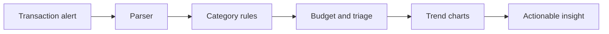

# Xpense Tracker

> A calm, local-first view of where your money goes.

Xpense Tracker ingests transaction alerts, extracts merchant and amount details, and turns uncategorized spending into a clear dashboard and analytics workflow.

## The money story



## Features

- Real-time SMS ingestion endpoint
- Merchant, amount, type, and date extraction
- Uncategorized expense triage
- Category, income, and spending analytics
- Supabase-backed real-time dashboard

## Quick start

```bash
git clone https://github.com/boss477/xpense-tracker.git
cd xpense-tracker
npm install
npm run dev
```

Configure Supabase using the environment variables in the setup guide. See [`assets/`](assets/) for screenshots and [`product-demo.mp4`](product-demo.mp4) for the walkthrough.

## Privacy

Transaction messages can contain sensitive financial information. Use a private Supabase project and restrict ingestion access.
